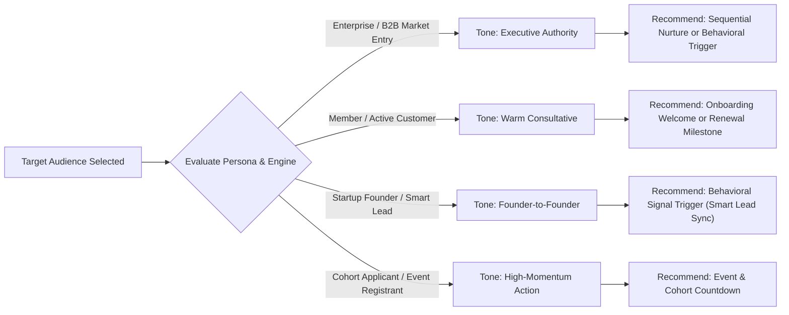

# Ticket 1: AI Email Automation Types & Trigger Configurations (Specification & Logic)

**Epic**: Email Marketing Automation Module & AI Integration  
**Priority**: High (Blocker for Creation Flow)  
**Owner**: Engineering & AI Architecture Team  
**Contract Reference**: [`lib/api/contracts/email-automation.ts`](file:///c:/Users/USER/Documents/p23-Africa/p23-marketing-engine/lib/api/contracts/email-automation.ts)

---

## 1. Executive Summary

Rather than enforcing rigid, manually assembled workflow trees, P23 Africa's Email Automation Engine uses an **AI-first recommendation architecture**. When a marketer selects an audience segment, business engine (`B2B Market Entry`, `Membership`, or `Paid Programmes`), or Smart Lead cohort, the AI engine dynamically recommends:
1. **Optimal Automation Flow Archetype** (e.g., Sequential Nurture vs. Behavioral Signal Trigger).
2. **Contextual Tone & Vibe Profile** (e.g., Executive Authority vs. Founder-to-Founder Warm).
3. **Pre-calibrated Trigger & Interval Schedule** with built-in deliverability guardrails and timezone-aware send windows (`Africa/Lagos` WAT / `Africa/Nairobi` EAT).

---

## 2. Core Supported Automation Types

The platform standardizes on **6 core AI-configurable automation archetypes**:

| ID | Automation Type | Primary Use Case | Default Steps | Recommended Engine |
| :--- | :--- | :--- | :---: | :--- |
| `sequential_nurture` | **Sequential Drip & Multi-Step Nurture** | Educational value-add sequences warming cold/warm leads toward a consultation or cohort application. | 4 steps | B2B Market Entry / Paid Programmes |
| `onboarding_welcome` | **Onboarding & Welcome Series** | Immediate post-signup or post-conversion activation sequence introducing key resources and relationship owners. | 3 steps | Membership / All Engines |
| `behavioral_trigger` | **Behavioral & Intent Signal Trigger** | Real-time response when a prospect opens 2+ emails, clicks a high-intent link, or triggers a Smart Lead social signal. | 3 steps | Smart Lead / B2B Market Entry |
| `re_engagement_winback` | **Re-Engagement & Dormant Win-Back** | Automated check-in for leads or customers with 21+ days of zero CRM activity or declining health scores (<60). | 3 steps | Customers / CRM |
| `event_programme_countdown` | **Event & Cohort Launch Countdown** | Time-anchored reminders leading up to a summit, roundtable, or accelerator cohort deadline. | 4 steps | Paid Programmes / B2B Market Entry |
| `milestone_renewal` | **Renewal & Expansion Milestone** | Proactive 30/14/3-day renewal and upsell prompts triggered by contract expiry or programme graduation. | 3 steps | Customers / Membership |

---

## 3. AI Tone & Vibe Suggestion Matrix

The AI Tone Engine evaluates **Target Audience Persona**, **Business Engine**, **Funnel Stage**, and **Geographic Market** to suggest one of four calibrated communication vibes:

### 3.1 Supported Tone Profiles

1. **`executive_corporate` — Executive & Institutional Authority**
   - **Characteristics**: Concise, data-backed, boardroom-ready, zero fluff, ROI and regulatory clarity.
   - **Best For**: Enterprise CFOs, Heads of Expansion, Institutional Partners, B2B Market Entry decision-makers.
   - **Linguistic Rules**: No exclamation marks in subject lines; lead with market thesis or regulatory insight; keep body under 130 words; sign off with formal executive title.

2. **`warm_consultative` — Warm Consultative & Relationship-First**
   - **Characteristics**: Empathetic, advisory, peer-to-peer partnership tone that balances professionalism with personal warmth.
   - **Best For**: P23 Community Members, Mid-Market Directors, Renewal conversations, and Warm CRM referrals.
   - **Linguistic Rules**: Reference shared ecosystem milestones; ask one open-ended diagnostic question; use inclusive "we/together" framing.

3. **`founder_casual` — Founder-to-Founder Direct & Conversational**
   - **Characteristics**: Authentic, punchy, low-friction, plain-text feel written like a quick note from a peer founder.
   - **Best For**: Startup Founders, Accelerator Cohort applicants, Smart Lead social signal outreach.
   - **Linguistic Rules**: Lowercase or conversational subject lines; 2–3 short paragraphs; single low-friction CTA (e.g., *"Worth a 10-min chat Thursday?"*).

4. **`urgent_action` — High-Momentum & Deadline-Driven**
   - **Characteristics**: Clear scarcity, social proof, and immediate next-step clarity without sounding spammy.
   - **Best For**: Cohort closing deadlines, VIP Summit seat confirmations, Hot leads (`>85` score).
   - **Linguistic Rules**: Time-bound subject line; bulleted value recap; direct calendar or registration link above the fold.

### 3.2 Dynamic Audience-to-Flow Recommendation Rules

---

## 4. Standard Trigger Setups & Sending Interval Rules

To prevent prospect fatigue and protect domain reputation, the AI auto-configures triggers and enforces strict sending interval rules:

### 4.1 Supported Trigger Events

| Trigger Key | Trigger Label | Source Module | Firing Condition |
| :--- | :--- | :--- | :--- |
| `lead_created_crm` | **New Lead Added to CRM** | CRM / Website Intake | Fires within 5 mins of lead creation in selected pipeline stage. |
| `smart_lead_synced` | **Smart Lead / ICP Match Synced** | Smart Lead | Fires when an AI-discovered lead (`score >= 70`) is synced or queued for outreach. |
| `stage_moved_qualified` | **Pipeline Stage → Qualified / Proposal** | CRM | Fires when a deal card enters `Qualified` or `Proposal Sent`. |
| `customer_health_drop` | **Customer Health Drop / Renewal Due** | Customers | Fires when account status becomes `Renewal due` or health score drops below `65`. |
| `intent_link_clicked` | **High-Intent Link Clicked / 2+ Opens** | Campaigns / Email | Fires when recipient clicks pricing/deck link or opens an email twice within 48h. |
| `inactivity_21d` | **21 Days Without Engagement** | CRM / Customers | Fires when `last_activity > 21 days` on an open opportunity or active member. |

### 4.2 Auto-Configured Sending Interval & Guardrail Rules

1. **Cadence Spacing Curves**:
   - **Sequential Nurture**: `Day 0 (Immediate)` → `Day 3 (+72h)` → `Day 7 (+96h)` → `Day 14 (+168h)`.
   - **Behavioral / Smart Lead Trigger**: ` +15 mins` → `Day 2 (+48h)` → `Day 5 (+72h)`.
   - **Onboarding Welcome**: `Immediate` → `Day 2 (+48h)` → `Day 6 (+96h)`.
   - **Re-Engagement Win-Back**: `Day 0` → `Day 4 (+96h)` → `Day 10 (+144h, Breakup/Close-file note)`.
2. **Smart Send Window Enforcement**:
   - Default window: **Tuesday–Thursday, 09:30–11:30 WAT (`Africa/Lagos`) / 11:30–13:30 EAT (`Africa/Nairobi`)**.
   - Weekend suppression enabled by default unless automation type is `event_programme_countdown`.
3. **Auto-Exit & Reply Suppression**:
   - **Stop-on-Reply**: Any inbound reply, calendar booking, or manual CRM stage progression immediately exits the recipient from remaining steps.
   - **Frequency Cap**: Maximum **1 automated email per 48 hours** per unique contact across all active workflows.
   - **Bounce & Unsubscribe Circuit Breaker**: Hard bounce or unsubscribe immediately suppresses the contact globally; workflows auto-pause if bounce rate exceeds `3.5%`.

---

## 5. AI Prompt & Dynamic Personalization Schema

When generating or refining sequence templates, the AI prompt builder injects the following structured variables:
- `{{first_name}}`, `{{company_name}}`, `{{role_title}}`
- `{{primary_engine}}` (`B2B Market Entry` | `Membership` | `Paid Programmes`)
- `{{corridor_market}}` (`Nigeria`, `Kenya`, `Ghana`, `South Africa`, `Egypt`, etc.)
- `{{intent_signal_summary}}` (populated dynamically from Smart Lead / Social Listening when available)
- `{{owner_name}}` & `{{owner_calendar_link}}` (assigned round-robin rep from CRM)
