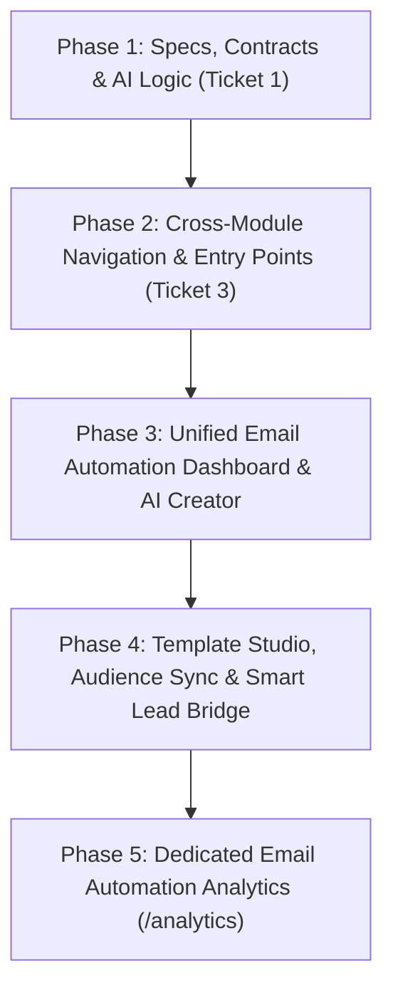

# Ticket 2: Email Marketing Feature Action Plan & Execution Roadmap

**Epic**: Email Marketing Automation Module & AI Integration  
**Assignee**: Emmanuel Nwachukwu  
**Priority**: High  
**Status**: Ready for Team Sign-Off  

---

## 1. Objective & Synthesis of Meeting Notes

Email marketing automation is a core growth multiplier across P23 Africa's three engines (**B2B Market Entry**, **Membership**, and **Paid Programmes**) and **Smart Lead**. Previously, email components existed as isolated outreach modals in CRM and Smart Lead without a unified automation hub, template editor, audience targeting engine, or dedicated analytics suite.

This action plan synthesizes our product, design, AI, and engineering requirements into a structured execution roadmap ensuring complete front-end and back-end alignment.

---

## 2. Feature Matrix, UI Placements & AI Dependencies

| Feature Pillar | UI Placement & Route | Core Capabilities | AI & Data Dependencies |
| :--- | :--- | :--- | :--- |
| **1. Unified Email Automation Dashboard** | `/email-automation` & nested inside `/campaigns` (`Email Automation` tab) | • 5 top-shelf P23 KPI cards (Active Workflows, Emails Sent, Open Rate, Click/Reply Rate, Pipeline Attributed) • Active/Paused/Draft automation workflows table & visual sequence step inspector • Quick pause/resume, duplicate, and test-send controls | • `lib/api/contracts/email-automation.ts` • Real-time workflow status & step-level conversion telemetry |
| **2. AI Workflow Creation Flow** | Modal & Builder inside `/email-automation` (`+ New AI Automation`) | • Target audience & engine selector • AI Auto-Recommendation engine suggesting Automation Type, Tone/Vibe, Trigger Event, and Interval Schedule • One-click "Apply AI Blueprint" to scaffold multi-step sequence | • Ticket 1 AI Recommendation Logic (`recommendAutomationBlueprint`) • Audience size estimator across CRM, Customers, and Smart Lead |
| **3. Interactive Template Editor** | Tab & Slide-over Inspector in `/email-automation` (`Template Studio`) | • Multi-step subject line & body editor with dynamic merge tags (`{{first_name}}`, `{{company_name}}`, `{{corridor_market}}`) • One-click AI Tone Rewriter (`Executive`, `Warm Consultative`, `Founder Casual`, `Urgent Action`) • Live preview & test email dispatch | • AI Tone transformation presets • Merge-tag validation & spam-word score check |
| **4. Audience & Smart Lead Targeting** | `Audience & Triggers` tab in `/email-automation` + `/smart-leads` bridge | • Cross-module audience segments linking CRM pipeline stages, Customer health cohorts, and Smart Lead ICP matches • Automated bi-directional data transmission between Smart Lead outreach and Email Automation sequences | • Smart Lead ICP profile & synced prospect counters • CRM & Customer segment filters |
| **5. Cross-Module Entry Points** | • Main Dashboard (`/dashboard`) • CRM (`/crm`) • Customers (`/customers`) • Campaigns (`/campaigns`) • Smart Lead (`/smart-leads`) | • Consistent `"View Email Automation"` button/tab in every module header/toolbar • Campaigns houses Email Automation as a nested sub-navigation tab rather than cluttering top-level navbar | • Deep-link support (`/email-automation?source=<module>`) to pre-contextualize audience or workflow view |
| **6. Dedicated Email Automation Analytics** | Analytics section (`/analytics`) | • Exclusively displays Email Automation Analytics & Reports • Deliverability, Open Rate, CTR, Reply Rate, and Sequence Conversion Funnel • Performance by AI Tone/Vibe & Automation Archetype • Saved Email Automation executive reports & CSV/PDF export | • `EMAIL_AUTOMATION_ANALYTICS` contract & interactive chart filters |

---

## 3. Phased Execution Roadmap (FE & BE Alignment)

### Phase 1: Specification, Data Contracts & AI Logic (Completed)
- **Deliverables**:
  - Finalize 6 core automation types, 4 AI tone/vibe profiles, 6 standard triggers, and interval guardrails ([`guides/email-automation-ai-specs.md`](file:///c:/Users/USER/Documents/p23-Africa/p23-marketing-engine/guides/email-automation-ai-specs.md)).
  - Implement TypeScript & Zod schemas in [`lib/api/contracts/email-automation.ts`](file:///c:/Users/USER/Documents/p23-Africa/p23-marketing-engine/lib/api/contracts/email-automation.ts) with deterministic AI recommendation engine (`getAiRecommendationForAudience`).
- **Back-End Alignment**: Standardize REST payload schemas for `/api/v1/email-automation/workflows`, `/api/v1/email-automation/ai-recommend`, and webhook event triggers.

### Phase 2: Cross-Module Navigation & Entry Points (Ticket 3)
- **Deliverables**:
  - Add `"View Email Automation"` entry point buttons/tabs to:
    1. **Main Dashboard** ([`components/dashboard/executive/executive-dashboard-view.tsx`](file:///c:/Users/USER/Documents/p23-Africa/p23-marketing-engine/components/dashboard/executive/executive-dashboard-view.tsx))
    2. **CRM** ([`app/(dashboard)/crm/page.tsx`](file:///c:/Users/USER/Documents/p23-Africa/p23-marketing-engine/app/(dashboard)/crm/page.tsx))
    3. **Customers** ([`components/customers/customers-view.tsx`](file:///c:/Users/USER/Documents/p23-Africa/p23-marketing-engine/components/customers/customers-view.tsx))
    4. **Campaigns** ([`components/campaigns/campaigns-view.tsx`](file:///c:/Users/USER/Documents/p23-Africa/p23-marketing-engine/components/campaigns/campaigns-view.tsx) — nested tab + direct `"View Email Automation"` route button)
    5. **Smart Lead** ([`components/sales-engine/sales-engine-view.tsx`](file:///c:/Users/USER/Documents/p23-Africa/p23-marketing-engine/components/sales-engine/sales-engine-view.tsx) — aligning standalone email outreach with the unified Email Automation dashboard)
  - Register `/email-automation` in global `⌘K` Command Palette ([`components/layout/command-palette.tsx`](file:///c:/Users/USER/Documents/p23-Africa/p23-marketing-engine/components/layout/command-palette.tsx)).

### Phase 3: Unified Email Automation Dashboard & AI Creation Workflow
- **Deliverables**:
  - Build [`app/(dashboard)/email-automation/page.tsx`](file:///c:/Users/USER/Documents/p23-Africa/p23-marketing-engine/app/(dashboard)/email-automation/page.tsx) and [`components/email-automation/email-automation-view.tsx`](file:///c:/Users/USER/Documents/p23-Africa/p23-marketing-engine/components/email-automation/email-automation-view.tsx).
  - Include AI Blueprint Creator modal that dynamically recommends flow type, tone/vibe, trigger configuration, and send intervals when an audience is chosen.

### Phase 4: Template Editor & Smart Lead Data Transmission Alignment
- **Deliverables**:
  - Interactive multi-step sequence & template editor with instant AI Tone shifting (`Executive Authority`, `Warm Consultative`, `Founder Casual`, `Urgent Action`) and merge-tag insertion.
  - Smart Lead data transmission card displaying live synced prospect queues and auto-enrollment toggle.

### Phase 5: Dedicated Email Automation Analytics (`/analytics`)
- **Deliverables**:
  - Upgrade [`components/analytics/analytics-view.tsx`](file:///c:/Users/USER/Documents/p23-Africa/p23-marketing-engine/components/analytics/analytics-view.tsx) so the Analytics tab exclusively displays **Email Automation Analytics & Reports** (Deliverability, Open/Click/Reply rates, Sequence Step Drop-off Funnel, AI Tone Performance comparison, and Automated Report Exports).

---

## 4. Sign-Off Checklist

- [x] **Ticket 1**: Documented specification of supported automation types, tone rules, and trigger configurations delivered.
- [x] **Ticket 1**: AI recommendation logic mapped out and codified to dynamically recommend flows and content based on selected target audience.
- [x] **Ticket 2**: Structured action plan document compiled and shared for sign-off.
- [x] **Ticket 3**: `"View Email Automation"` entry points added to Dashboard, CRM, Customers, Campaigns (nested), and Smart Lead, routing cleanly to the Email Automation Dashboard, with Analytics exclusively displaying email automation analytics and reports.
