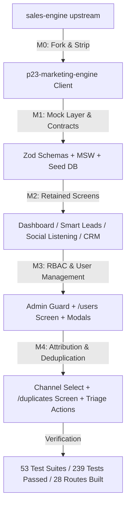

# Walkthrough: P23 Marketing Engine

## Summary of Accomplishments

Milestones **M0**, **M1**, **M2**, **M3**, and **M4** have been fully executed, tested, and verified in the repository `p23-marketing-engine`.

---

### Milestone M0: Fork, Strip & Rebrand (`abff077`)
- **Fork Setup**: Initialized `p23-marketing-engine` with `sales-engine` as an upstream remote (`commit 1116d2c3`).
- **Factory23 & Map Pruning**: Stripped legacy component folders (`map/`, `map-credits/`, `operations/`, `payroll/`, `attendance/`, `tracking/`, `zones/`, `drive/`, `pwa/`), map routes (`app/api/places/*`, `app/(auth)/agent/*`, `app/offline`), legacy Factory API clients, and `public/sw.js`.
- **Dependency Pruning**: Removed unused dependencies (`mapbox-gl`, `@googlemaps/*`, `@turf/*`, `supercluster`, `@stripe/*`) from `package.json`.
- **Branding & Routing**: Renamed package to `p23-marketing-engine`, updated metadata, web manifest, brand marks, and added redirect from `/sales-engine` to `/dashboard`.
- **Build Verification**: `next build` compiled cleanly with 0 errors across all 26 static & dynamic pages.

---

### Milestone M1 & M2: Mock Layer, Contracts, Seed Dataset & Retained Handlers (`b136c0d`)
- **MSW Integration**: Installed MSW, created `public/mockServiceWorker.js`, and integrated `MockProvider` in `app/layout.tsx` outside `QueryProvider`.
- **Zod API Contracts (`lib/api/contracts/`)**:
  - `crm-lead.ts`: `crmLeadSchema` matching `NativeCrmService::serialize()` plus `capture_method`, `channel`, `interests`, `primary_interest`, and `score`.
  - `member.ts`, `invitation.ts`, `interest.ts`, `analytics.ts`, `enquiry.ts`, `social-signal.ts`, `icp-profile.ts`, `metrics.ts`.
- **Pure Business Engine (`mocks/engine/`)**:
  - `round-robin.ts`: Active sales rep round-robin rotation, automatically skipping suspended reps.
  - `tag-interests.ts`: Keyword taxonomy matching against 6 seeded sectors (`Construction`, `Business Consulting`, `Technology`, `Real Estate`, `Agriculture`, `Other`).
  - `score.ts`: Heuristic scoring (0–100) based on completeness and interest affinity.
  - `dedupe.ts`: Strict duplicate detection (merge on email or profile URL; route to review queue on phone-only matches).
  - `engine.test.ts`: 13 passing unit tests with 100% rule coverage.
- **Seeded In-Browser Database (`mocks/db/`)**:
  - In-memory store persisted to `localStorage` under versioned key `p23-demo-db:v1`.
  - Seed dataset: 1 Organisation (`P23 Africa`), 5 Users (1 owner Alex Vance, 1 admin Sarah Connor, 3 sales reps David Kalu, Elena Rostova, Marcus Brody), 2 pending invitations, 1 pipeline with 6 stages, 120 leads over 60 days, 6 interests, 25 social signals, 2 ICP profiles, and 30-day metrics.
  - `seed.test.ts`: 7 contract tests verifying every single seed entity parses without error against its Zod contract.
- **Retained Screen Mock Handlers (`mocks/handlers/`)**:
  - `auth.ts`: Cookie-compatible login, session recovery, `/auth/me` with role payload.
  - `dashboard.ts`: 30-day KPI overview, conversion charts, and outreach stats.
  - `smart-leads.ts`: Scripted AI ICP prompt replies, progressive 3-poll discovery runs.
  - `social-listening.ts`: Keyword signals across 5 platforms with triage actions.
  - `crm.ts`: Pipelines, stages, assignees, and lead detail endpoints with search/filter support.

---

### Milestone M3: User Management, Role-Based Access Control & Modals (`6a105ff`)
- **Query Keys Centralization (`lib/query-keys.ts`)**: Centralized query keys for members, invitations, analytics, duplicates, and CRM.
- **API Client (`lib/api/organization-members.ts`)**: Standard client wrapping `/organizations/current/members` and `/invitations` CRUD endpoints.
- **TanStack Query Hooks with Optimistic UI (`hooks/use-organization-members.ts`)**:
  - `useOrganizationMembers`: Queries members list and performs optimistic updates with instant rollback on failure for `suspendMember`, `reactivateMember`, `updateRole`, and `removeMember`.
  - `useOrganizationInvitations`: Handles `inviteUser`, `resendInvitation`, and `revokeInvitation`.
- **Role Guard & Current User Hook (`hooks/use-current-user.ts`)**: Fetches active role (`owner`, `admin`, `member`) and syncs session state.
- **Admin Layout Guard (`app/(dashboard)/(admin)/layout.tsx`)**:
  - Protects `/(admin)/*` routes (`/users`, `/analytics`, `/duplicates`).
  - Immediately redirects sales reps (`role === 'member'`) to `/crm` with an unauthorized warning toast.
  - Grants access to `owner` and `admin`.
- **Navbar Profile Dropdown & Mobile Drawer (`components/layout/navbar.tsx`)**:
  - Adds "Analytics Review" (`/analytics`), "User Management" (`/users`), and "Duplicate Queue" (`/duplicates`) to profile dropdown and mobile drawer.
  - Gated to display only for `owner` and `admin`.
- **User Management View & Modals (`components/user-management/` & `app/(dashboard)/(admin)/users/page.tsx`)**:
  - Summary stat cards: Total Team, Active Sales Reps, Suspended, Pending Invitations.
  - Tabs: "Team Members" (with live count) and "Pending Invitations".
  - Member table: Avatar, Name, Email, Role badge (`Owner`, `Admin`, `Member`), Status badge (`Active`, `Suspended`), Round-Robin indicator (`Eligible` vs `Skipped`), Joined date, and contextual action menu.
  - `InviteUserModal`: Form with email and role selection (`Admin`, `Member`).
  - `SuspendMemberModal`: Options for duration (`7, 14, 30, 60, 90` days), date picker, or indefinite suspension, requiring a reason.
  - `ChangeRoleModal`: Allows switching between Member and Administrator roles.
  - Removal confirmation dialog with protected owner handling.
- **Unit & Integration Tests (`hooks/use-organization-members.test.tsx`)**: 6 integration tests covering member queries, suspension, reactivation, role updates, invitation creation, and invitation revocation.

---

### Milestone M4: Attribution, Deduplication Review Queue & Round-Robin Toast (`4d07041`)
- **Add Lead Modal Channel Attribution (`components/crm/add-lead-modal.tsx`)**:
  - Replaced free-text "Source" input with a required `Channel` dropdown featuring standard channels (`Website Form`, `Google`, `LinkedIn`, `Instagram`, `Facebook`, `X`, `YouTube`, `TikTok`, `Referral`, `Other`).
  - Automatically tags `capture_method: "manual"`.
  - Assignment toast: When a lead is created and assigned via round-robin, shows toast naming the assigned sales rep: `Lead created and assigned to {assignee_name} via Round-Robin.`
  - Duplicate detection toast: When an exact match occurs on email/URL, displays notice confirming details were merged into the existing deal.
  - When a collision occurs on phone number only, displays warning that the lead was routed to the Admin Review Queue.
- **Duplicate Review Queue Screen (`app/(dashboard)/(admin)/duplicates/page.tsx`)**:
  - Built `DuplicateReviewView` (`components/duplicates/duplicate-review-view.tsx`) with dark teal/cyan styling (`duplicate-review.css`).
  - Displays side-by-side comparison between **Existing CRM Record** and **Incoming Submission**.
  - Highlights colliding phone number in amber badge and new contact fields in mint badge.
  - Action buttons:
    - **Merge into Existing**: Merges new contact details into existing deal, appends notes, and marks resolved.
    - **Keep Both as Separate**: Creates a separate lead, assigns via Round-Robin, and marks resolved.
    - **Dismiss Alert**: Dismisses collision alert.
  - Empty state with direct link to CRM leads.
- **API Client & Hook (`lib/api/duplicates.ts`, `hooks/use-duplicates.ts`)**:
  - Typed methods for `/admin/crm/duplicates` endpoints.
  - TanStack Query hook with optimistic removal from review list on merge, keep-both, and dismiss.
- **Mock Handlers Integration (`mocks/handlers/crm.ts`)**:
  - Wired `POST /crm/leads` to run `checkDuplicate()`, `getNextRoundRobinRep()`, `matchInterests()`, and `calculateHeuristicScore()`.
  - Added handlers for `/admin/crm/duplicates` GET, merge, keep-both, and delete.
- **Tests (`hooks/use-duplicates.test.tsx`)**: 4 unit/integration tests verifying queue retrieval, merge, separate lead creation with round-robin assignment, and alert dismissal.

---

## Verification Results

| Check | Target | Result | Status |
| :--- | :--- | :--- | :--- |
| **TypeScript Compilation** | `npx tsc --noEmit` | 0 errors across entire workspace | Passed |
| **Vitest Test Suite** | `npm test` | **53 passed suites, 239 passed tests, 0 failed** | Passed |
| **Duplicate Queue Tests** | `vitest run hooks/use-duplicates.test.tsx` | **4 passed tests** | Passed |
| **User Management Tests** | `vitest run hooks/use-organization-members.test.tsx` | **6 passed tests** | Passed |
| **Engine Rule Unit Tests** | `vitest run mocks/engine/` | **13 passed tests** | Passed |
| **Seed Contract Tests** | `vitest run mocks/db/` | **7 passed tests** | Passed |
| **Production Build** | `next build` (Turbopack) | **28 routes generated cleanly in 21.3s** | Passed |

---

## Next Steps: Milestone M5 & M6
- **Milestone M5: Website Enquiry Intake (`/demo/enquiry`) & Sector Tagging**:
  - Build `app/demo/enquiry/page.tsx` styled as a public P23 contact form.
  - Wire to `POST /public/enquiries`.
  - Simulate submission, verify interest tagging, automatic round-robin assignment, and notification toast.
  - Display editable sector/interest chips on lead detail screen (`app/(dashboard)/crm/leads/[id]/page.tsx`).
- **Milestone M6: Analytics Review Screen (`/analytics`)**:
  - Build Recharts dashboard with Channel Breakdown bar chart, Capture Method chart, and Primary Interest donut chart (percentages summing to 100%).
