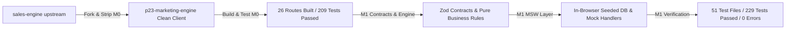

# Walkthrough: P23 Marketing Engine (Milestones M0 & M1 Completed)

## Summary of Accomplishments

Milestones **M0** and **M1** have been executed and verified in the target repository `p23-marketing-engine`.

---

### Milestone M0: Fork, Strip & Rebrand
- **Fork Setup**: Initialized `p23-marketing-engine` with `sales-engine` as an upstream remote (`commit 1116d2c3`).
- **Factory23 & Map Pruning**: Stripped legacy component folders (`map/`, `map-credits/`, `operations/`, `payroll/`, `attendance/`, `tracking/`, `zones/`, `drive/`, `pwa/`), map routes (`app/api/places/*`, `app/(auth)/agent/*`, `app/offline`), legacy Factory API clients, and `public/sw.js`.
- **Dependency Pruning**: Removed unused dependencies (`mapbox-gl`, `@googlemaps/*`, `@turf/*`, `supercluster`, `@stripe/*`) from `package.json`.
- **Branding & Routing**: Renamed package to `p23-marketing-engine`, updated metadata, web manifest, brand marks, and added redirect from `/sales-engine` to `/dashboard`.
- **Build Verification**: `next build` compiled cleanly with 0 errors across all 26 static & dynamic pages.

---

### Milestone M1: Mock Layer, Contracts & Seed Dataset
- **MSW Integration**: Installed MSW, created `public/mockServiceWorker.js`, and integrated `MockProvider` in `app/layout.tsx` outside `QueryProvider`.
- **Zod API Contracts (`lib/api/contracts/`)**:
  - `crm-lead.ts`: `crmLeadSchema` matching `NativeCrmService::serialize()` plus `capture_method`, `channel`, `interests`, `primary_interest`, and `score`.
  - `member.ts`, `invitation.ts`, `interest.ts`, `analytics.ts`, `enquiry.ts`, `social-signal.ts`, `icp-profile.ts`, `metrics.ts`.
- **Pure Business Engine (`mocks/engine/`)**:
  - `round-robin.ts`: Active sales rep round-robin rotation, automatically skipping suspended reps.
  - `tag-interests.ts`: Keyword taxonomy matching against 6 seeded sectors (`Construction`, `Business Consulting`, `Technology`, `Real Estate`, `Agriculture`, `Other`).
  - `score.ts`: Heuristic scoring (0–100) based on completeness and interest affinity.
  - `dedupe.ts`: Strict duplicate detection (merge on email or profile URL; route to review queue on phone-only matches).
  - `engine.test.ts`: 13 passing unit tests with 100% rule coverage.
- **Seeded In-Browser Database (`mocks/db/`)**:
  - In-memory store persisted to `localStorage` under versioned key `p23-demo-db:v1`.
  - Seed dataset: 1 Organisation (`P23 Africa`), 5 Users (1 owner Alex Vance, 1 admin Sarah Connor, 3 sales reps David Kalu, Elena Rostova, Marcus Brody), 2 pending invitations, 1 pipeline with 6 stages, 120 leads over 60 days, 6 interests, 25 social signals, 2 ICP profiles, and 30-day metrics.
  - `seed.test.ts`: 7 contract tests verifying every single seed entity parses without error against its Zod contract.
- **Mock Service Worker Handlers (`mocks/handlers/`)**:
  - Auth, Workspace, Members, CRM, Analytics, Enquiries, Smart Leads (scripted chat & progressive discovery runs), Social Listening, Dashboard metrics, and Outreach.

---

## Verification Results

| Check | Target | Result | Status |
| :--- | :--- | :--- | :--- |
| **TypeScript Compilation** | `npx tsc --noEmit` | 0 errors across entire workspace | Passed |
| **Vitest Test Suite** | `npm test` | **51 passed suites, 229 passed tests, 0 failed** | Passed |
| **Engine Rule Unit Tests** | `vitest run mocks/engine/` | **13 passed tests** | Passed |
| **Seed Contract Tests** | `vitest run mocks/db/` | **7 passed tests** | Passed |
| **Production Build** | `next build` (Turbopack) | **26 routes generated in 47s** | Passed |

---

## Next Steps: Milestone M2 & M3
- **M2**: Finalize retained screen verification on dummy data.
- **M3**: User Management screen (`/users`), RBAC layout guard in `app/(dashboard)/(admin)/layout.tsx`, and navbar profile dropdown additions.
